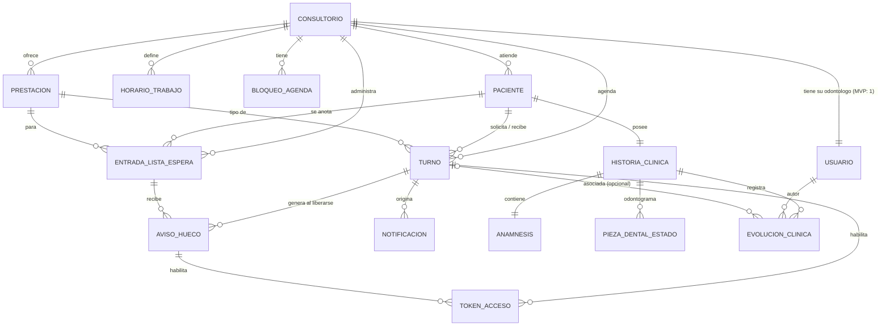

# Modelo de Datos

Base PostgreSQL local gestionada con Flyway (ver DD-04). Todas las entidades tienen `id` (BIGINT identity; **Suposición:** BIGINT para entidades internas, token aleatorio de 128+ bits para enlaces públicos), `creado_en` y `actualizado_en`.

**`Consultorio` desde el día 1:** existe una entidad `consultorio` (una sola instancia en el MVP) de la que cuelgan odontólogo, pacientes, turnos, configuración y lista de espera mediante `consultorio_id`. Esto permite crecer a multi-consultorio sin reescribir el modelo. El MVP **no** es multi-tenant: no hay aislamiento por tenant ni selección de consultorio en la interfaz.

## Dominios

| Dominio | Entidades |
|---------|-----------|
| Identidad y acceso | `usuario` (el odontólogo) |
| Configuración del consultorio | `consultorio`, `prestacion`, `horario_trabajo`, `bloqueo_agenda` |
| Pacientes | `paciente` (sin cuenta), historial de ausencias (derivado de `turno`) |
| Agenda | `turno` |
| Lista de espera | `entrada_lista_espera`, `aviso_hueco` |
| Notificaciones y tokens | `notificacion`, `token_acceso` |
| Clínico | `historia_clinica`, `anamnesis`, `pieza_dental_estado`, `evolucion_clinica` |

## ERD (Entity Relationship Diagram)



## Entidades

### consultorio
- `id`, `nombre`, `direccion`, `telefono`, `email_contacto`, `zona_horaria` (default `America/Argentina/Buenos_Aires`), `granularidad_min` (default 15), `anticipacion_min_reserva_min`, `limite_cancelacion_horas`, `recordatorio_horas_antes` (default 24), `vencimiento_aviso_min`, `vencimiento_pendiente_min` (TTL de solicitud pública sin confirmar).
- Relaciones: 1 `usuario` (odontólogo) en el MVP; N `prestacion`, `horario_trabajo`, `bloqueo_agenda`, `paciente`, `turno`, `entrada_lista_espera`.
- **MVP:** una sola fila (la aplicación la lee por configuración; sin selección de consultorio). El modelo **no** impone una restricción de fila única para no bloquear el crecimiento a multi-consultorio.

### usuario (el odontólogo)
- `id`, `consultorio_id`, `email` (único, citext), `password_hash`, `nombre`, `apellido`, `matricula` (**Suposición:** texto libre), `activo` (bool), `ultimo_acceso`.
- Es el **único usuario con login**. No hay campo de rol: un solo tipo de usuario en el MVP (si en el futuro hay más tipos, se agrega `rol`).
- Constraints: `email` único.

### prestacion (tipo de turno)
- `id`, `consultorio_id`, `nombre` (único por consultorio), `duracion_min` (múltiplo de la granularidad), `activa`.

### horario_trabajo
- `id`, `consultorio_id`, `dia_semana` (1-7), `hora_desde`, `hora_hasta`.
- Constraint: `hora_desde < hora_hasta`; sin solapamiento por consultorio y día (exclusión).
- **Nota de crecimiento:** al incorporar más odontólogos se agrega `usuario_id`; en el MVP el horario del consultorio es el del odontólogo.

### bloqueo_agenda
- `id`, `consultorio_id`, `desde` (timestamptz), `hasta`, `motivo`.
- Constraint: `desde < hasta`.

### paciente
- `id`, `consultorio_id`, `nombre`, `apellido`, `dni`, `fecha_nacimiento` (nullable), `telefono`, `email`, `direccion` (opcional), `cantidad_ausencias` (contador derivado; ver RN-AS-02), `activo`.
- **Sin cuenta ni contraseña.** Se crea al primer pedido público o por carga del odontólogo; se identifica por DNI (RN-PU-04).
- Constraint: (`consultorio_id`, `dni`) único. Índices: `dni`, `email`, (`apellido`, `nombre`).

### turno
- `id`, `consultorio_id`, `paciente_id`, `prestacion_id`, `inicio` (timestamptz), `fin` (timestamptz, = inicio + duración), `estado`, `origen` (`PUBLICA | ODONTOLOGO | LISTA_ESPERA`), `pendiente_hasta` (timestamptz, solo para `PENDIENTE_CONFIRMACION`), `motivo_cancelacion`, `cancelado_por` (`ODONTOLOGO | PACIENTE | SISTEMA`), `version` (optimistic locking, `@Version`).
- `estado`: `PENDIENTE_CONFIRMACION` (solicitud pública a la espera del enlace de email), `RESERVADO`, `CONFIRMADO`, `CANCELADO`, `AUSENTE`, `ATENDIDO`, `EXPIRADO` (solicitud no confirmada a tiempo).
- **Constraint crítico** (extensión `btree_gist` de PostgreSQL local; garantiza no superposición en la agenda del odontólogo):
  ```sql
  EXCLUDE USING gist (consultorio_id WITH =, tstzrange(inicio, fin, '[)') WITH &&)
    WHERE (estado IN ('PENDIENTE_CONFIRMACION','RESERVADO','CONFIRMADO'));
  CHECK (inicio < fin);
  ```
  Como el MVP tiene un solo odontólogo por consultorio, la agenda del odontólogo es la del consultorio. Al sumar odontólogos se agrega `usuario_id` a `turno` y a la restricción.
- Una solicitud `PENDIENTE_CONFIRMACION` **retiene el hueco** hasta `pendiente_hasta`; antes de cada reserva, y por el scheduler, las vencidas pasan a `EXPIRADO` (RN-PU-02).
- Índices: (`consultorio_id`, `inicio`), (`paciente_id`, `inicio`), (`estado`, `inicio`).
- **Suposición:** los estados `ATENDIDO` y `AUSENTE` salen de la restricción (el rango ya pasó); alternativa: incluir `ATENDIDO`. Se resuelve en implementación (ver [10](10_preguntas_abiertas.md)).

### entrada_lista_espera
- `id`, `consultorio_id`, `paciente_id`, `prestacion_id`, `fecha_desde`, `fecha_hasta`, `franja_desde`, `franja_hasta` (nullable), `estado` (`PENDIENTE_CONFIRMACION | ACTIVA | CUBIERTA | CANCELADA | VENCIDA`), `origen` (`PUBLICA | ODONTOLOGO`), `turno_resultante_id` (nullable).
- Las entradas de la página pública nacen `PENDIENTE_CONFIRMACION` y pasan a `ACTIVA` al confirmar el email (RN-PU-05); las cargadas por el odontólogo nacen `ACTIVA`.
- Constraint: no más de una entrada ACTIVA o pendiente por (`paciente_id`, `prestacion_id`) (**Suposición**).

### aviso_hueco
- `id`, `turno_origen_id` (turno cancelado que liberó el hueco), `entrada_lista_espera_id`, `inicio`, `fin`, `prestacion_id`, `estado` (`ENVIADO | ACEPTADO | EXPIRADO | CERRADO`), `vence_en`.
- Un hueco liberado genera N avisos (uno por paciente compatible), todos para el mismo rango; el primer `aceptar` exitoso cierra los demás. Cada aviso tiene su `token_acceso`.

### token_acceso
- `id`, `proposito` (`CONFIRMAR_SOLICITUD | CONFIRMAR_TURNO | CANCELAR_TURNO | ACEPTAR_AVISO | CONFIRMAR_LISTA_ESPERA`), `turno_id` (nullable), `aviso_id` (nullable), `entrada_lista_espera_id` (nullable), `token_hash` (SHA-256 del token aleatorio; el token en claro solo viaja en el email), `vence_en`, `usado_en`.
- **Un token único por turno o por aviso** (y por entrada pendiente de lista de espera); vencimiento y un solo uso. Constraint: exactamente una de las FK no nula.

### notificacion
- `id`, `tipo` (`CONFIRMAR_SOLICITUD | CONFIRMACION_TURNO | RECORDATORIO | AVISO_HUECO | CANCELACION | AUSENTE_REPROGRAMAR | CONFIRMAR_LISTA_ESPERA`), `canal` (`EMAIL`; luego `WHATSAPP`), `destinatario`, `turno_id` (nullable), `aviso_id` (nullable), `estado` (`PENDIENTE | ENVIADA | FALLIDA`), `intentos`, `error`, `programada_para`, `enviada_en`.
- Índice único (`turno_id`, `tipo`) para recordatorios (idempotencia; RN-NO-03) y (`aviso_id`) para avisos de hueco.

### historia_clinica
- `id`, `paciente_id` (único). Una sola HC por paciente (una por establecimiento, art. 17 Ley 26.529).

### anamnesis
- `id`, `historia_id` (único), `alergias`, `medicacion_actual`, `enfermedades_previas`, `antecedentes_relevantes`, `embarazo` (nullable), `observaciones`. **Suposición:** campos de texto simples en el MVP.

### pieza_dental_estado
- `id`, `historia_id`, `pieza_fdi` (11-18, 21-28, 31-38, 41-48; temporarias 51-55, 61-65, 71-75, 81-85), `estado` (enum, ver abajo), `observacion`, `actualizado_por` (usuario), `actualizado_en`.
- Constraint: único (`historia_id`, `pieza_fdi`); `pieza_fdi` validada contra el conjunto FDI.
- Estados MVP (**Suposición**): `SANA`, `CARIES`, `OBTURADA`, `CORONA`, `ENDODONCIA`, `AUSENTE`, `IMPLANTE`, `FRACTURADA`, `A_EXTRAER`. Alcance por pieza completa (no por cara) en el MVP; caras en etapa posterior.

### evolucion_clinica
- `id`, `historia_id`, `usuario_id` (autor: el odontólogo), `turno_id` (nullable), `fecha`, `nota` (texto), `creada_en`.
- En el MVP es editable por su autor dentro de una ventana (**Suposición**); en la etapa posterior pasa a *append-only* (ver RN-HC-05).

## Seed data inicial

Todos los datos son **ficticios**.

| Dato | Contenido |
|------|-----------|
| Consultorio | 1 registro "Consultorio Demo", granularidad 15 min, recordatorio 24 h, TTL de solicitud pendiente 30 min |
| Usuario | 1 odontólogo ficticio; su contraseña inicial se toma de una variable de entorno de bootstrap (`BOOTSTRAP_ODONTOLOGO_PASSWORD`), nunca del repositorio |
| Prestaciones | Consulta (30 min), Limpieza (45 min), Obturación (60 min), Endodoncia (90 min), Extracción (45 min), Control (15 min) |
| Horarios | Lunes a viernes 09:00-13:00 y 14:00-18:00 (**Suposición**) |
| Pacientes ficticios | 10 con DNI, email y teléfono inventados |
