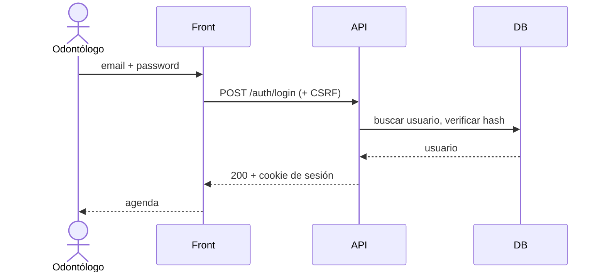
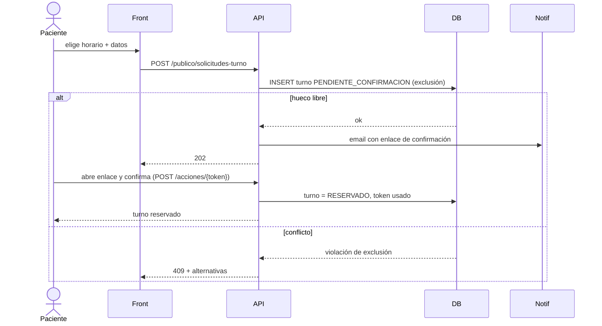
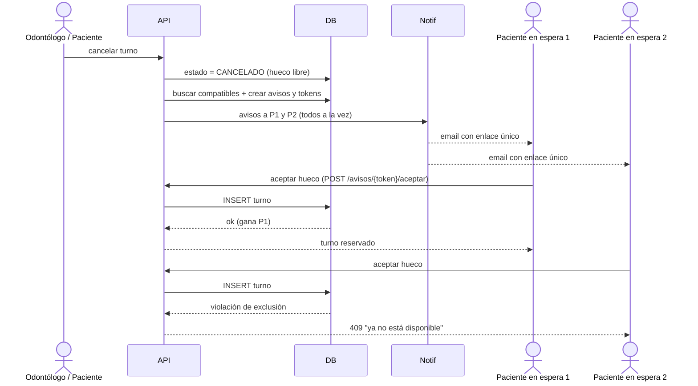

# Flujos Principales

Cada flujo se documenta extremo a extremo. Los componentes son: **Front** (TS vanilla), **API** (Spring Boot), **DB** (PostgreSQL local), **Notif** (puerto de notificaciones, adaptador email/SMTP), **Sched** (`@Scheduled` interno). El **odontólogo** es el único usuario con login; el **paciente** no tiene cuenta.

## Flujo 1: Inicio de sesión del odontólogo

**Disparador**: el odontólogo abre la aplicación.
**Actor**: Odontólogo.

**Pasos**:
1. Front carga `/login` y obtiene la cookie `XSRF-TOKEN` (CSRF).
2. Front envía `POST /api/v1/auth/login` con email y contraseña y la cabecera `X-XSRF-TOKEN`.
3. API verifica el hash, crea la **sesión de servidor** (rotando el identificador) y responde `200` con `Set-Cookie: JSESSIONID` (`HttpOnly`).
4. El navegador envía la cookie automáticamente en cada llamada; el Front envía además `X-XSRF-TOKEN` en las escrituras.

**Casos de error**:
- Credenciales inválidas → `401` genérico; limitación de intentos (RN-AU-09).
- Falta o es inválido el token CSRF → `403`.
- Sesión expirada → `401` y redirección a `/login`.

## Flujo 2: Solicitud de turno desde la página pública

**Disparador**: un paciente quiere un turno.
**Actor**: Paciente (sin cuenta).

**Pasos**:
1. Front solicita `GET /api/v1/publico/disponibilidad` con prestación y rango de fechas.
2. API calcula huecos: horario de trabajo, menos bloqueos, menos turnos activos (incluye pendientes), con duración suficiente (granularidad 15 min).
3. El paciente elige un horario e ingresa nombre, DNI, email y teléfono; Front envía `POST /publico/solicitudes-turno` (aplica limitación de tasa y campo señuelo).
4. API, en una transacción: marca como `EXPIRADO` las pendientes vencidas, busca o crea el paciente por DNI, y hace `INSERT` del turno en `PENDIENTE_CONFIRMACION` con `pendiente_hasta`; la restricción de exclusión garantiza que no haya superposición.
5. API crea un `token_acceso` (hasheado) y encola una notificación `CONFIRMAR_SOLICITUD` con el enlace; responde `202` con mensaje genérico (RN-PU-07).
6. El paciente abre el enlace del email (`GET /acciones/{token}` muestra el resumen) y pulsa "Confirmar" (`POST`).
7. API valida el token (vigencia, uso único, propósito), pasa el turno a `RESERVADO`, invalida el token y encola `CONFIRMACION_TURNO`.

**Casos de error**:
- Hueco tomado entre la consulta y la solicitud → `409`; Front recarga disponibilidad.
- Excede limitación de tasa → `429`.
- Fuera de horario o con bloqueo → `422`.
- El paciente no confirma a tiempo → el scheduler pasa el turno a `EXPIRADO` y libera el hueco.
- Falla el email → la solicitud se mantiene; la notificación queda `FALLIDA` y se reintenta (RN-NO-06).

## Flujo 3: Cancelación y recuperación por lista de espera

**Disparador**: se cancela o se mueve un turno.
**Actor**: Odontólogo (agenda) o Paciente (enlace del recordatorio).

**Pasos**:
1. API cambia el turno a `CANCELADO` y libera el hueco (la restricción deja de aplicar).
2. En la misma transacción se publica un evento `HuecoLiberado`.
3. El manejador busca entradas `ACTIVA` compatibles (RN-LE-02), una por paciente (RN-LE-08).
4. Crea un `aviso_hueco` por paciente con su `token_acceso` único (hasheado, con vencimiento) y encola un email `AVISO_HUECO` para **todos**.
5. Cada paciente abre su enlace (`GET /avisos/{token}` muestra el hueco) y pulsa "Aceptar" (`POST /avisos/{token}/aceptar`), sin login.
6. API intenta `INSERT` del turno `RESERVADO` para ese hueco. El primero tiene éxito; el resto recibe conflicto.
7. Al éxito: la entrada pasa a `CUBIERTA`, los demás avisos a `CERRADO`, y se notifica la confirmación al ganador.
8. Si nadie acepta antes del vencimiento, los avisos pasan a `EXPIRADO` y el hueco queda libre para reserva normal.

**Casos de error**:
- Dos aceptaciones simultáneas del mismo hueco → una falla por restricción de exclusión (DD-06).
- Aviso vencido o token usado → `410 Gone`.

## Flujo 4: Anotarse en la lista de espera desde la página pública

**Disparador**: no hay horario conveniente y el paciente quiere que le avisen.
**Actor**: Paciente (sin cuenta) u Odontólogo.

**Pasos**:
1. El paciente completa prestación, rango de fechas, franja y sus datos (nombre, DNI, email, teléfono); Front envía `POST /publico/lista-espera` (con limitación de tasa).
2. API crea la entrada `PENDIENTE_CONFIRMACION` y envía un email con enlace de confirmación.
3. Al confirmar el enlace, la entrada pasa a `ACTIVA` (RN-PU-05).
4. Alternativa: el odontólogo la carga con sesión (`POST /lista-espera`) y nace `ACTIVA`.

**Casos de error**:
- Entrada duplicada para la misma prestación → `409`.
- No confirma el email → la entrada nunca recibe avisos y se depura por vencimiento.

## Flujo 5: Recordatorio 24 h antes y confirmación

**Disparador**: scheduler periódico.
**Actor**: Sistema; Paciente.

**Pasos**:
1. `@Scheduled` se ejecuta cada pocos minutos (**Suposición:** cada 5 min).
2. Busca turnos `RESERVADO` cuyo inicio caiga en la ventana "ahora + 24 h" y sin recordatorio previo (RN-NO-03).
3. Para cada uno crea tokens `CONFIRMAR_TURNO` y `CANCELAR_TURNO` (únicos por turno) y una notificación; Notif envía el email.
4. El paciente pulsa un enlace → `GET /acciones/{token}` muestra la acción y `POST` la ejecuta.
5. API valida token (vigencia, uso único, propósito), actualiza el turno a `CONFIRMADO` o `CANCELADO` e invalida el token.
6. Si fue cancelación, se continúa en el Flujo 3.

**Casos de error**:
- Token vencido o usado → página informativa, sin cambios.
- Turno ya cancelado → mensaje de estado actual.
- Reinicio del proceso → la idempotencia evita duplicados.

## Flujo 6: Ausencia de paciente

**Disparador**: el paciente no se presenta.
**Actor**: Odontólogo.

**Pasos**:
1. Pasada la hora de inicio más tolerancia, el odontólogo marca el turno como ausente (`POST /turnos/{id}/ausente`).
2. API cambia el estado a `AUSENTE`, registra la ausencia en el historial y suma el contador del paciente.
3. Se crea una notificación `AUSENTE_REPROGRAMAR` con enlace a la página pública de reserva.
4. Notif envía el email al paciente.

**Casos de error**:
- Se intenta marcar antes de la tolerancia → `422`.
- Marca equivocada → reversión dentro de 24 h (RN-AS-06).

## Flujo 7: Atención clínica

**Disparador**: el paciente llega a su turno.
**Actor**: Odontólogo.

**Pasos**:
1. El odontólogo abre su agenda del día y selecciona el turno.
2. Front carga `GET /pacientes/{id}/historia` (anamnesis, odontograma, evoluciones).
3. Durante o tras la atención, actualiza piezas (`PUT .../odontograma/piezas/{fdi}`) y agrega una nota de evolución.
4. Marca el turno como `ATENDIDO`.

**Casos de error**:
- Sin sesión → `401`.
- Pieza FDI inválida → `422`.

## Flujo 8: Configuración inicial del consultorio

**Disparador**: puesta en marcha del sistema.
**Actor**: Odontólogo (tras el seed/bootstrap).

**Pasos**:
1. El seed crea el `Consultorio` y el usuario odontólogo (contraseña desde variable de entorno).
2. El odontólogo inicia sesión y crea las prestaciones con duración.
3. Define horarios semanales y bloqueos.
4. Ajusta parámetros (granularidad, recordatorio, límites, TTL de solicitud pendiente).

**Casos de error**:
- Duración no múltiplo de la granularidad → `422`.
- Horarios solapados → `422`.
