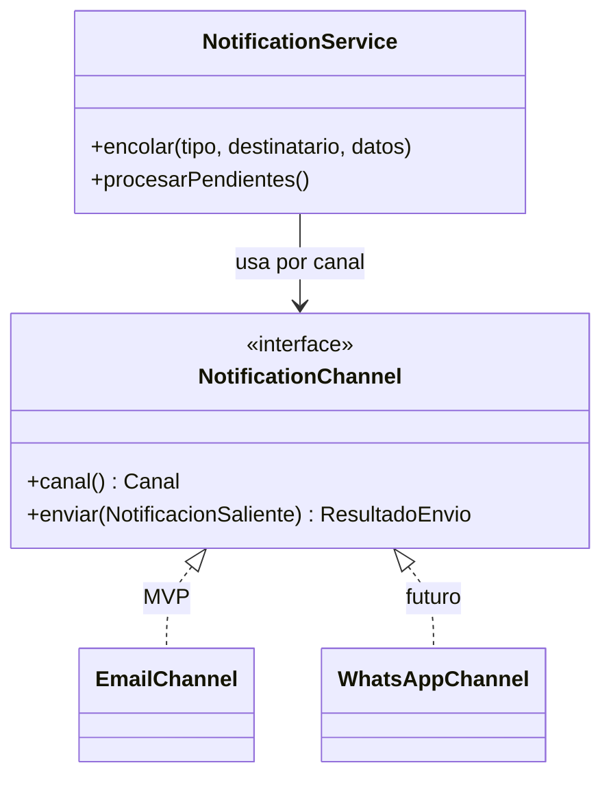

# Notificaciones

El sistema envía notificaciones por **email en el MVP**. **WhatsApp Business API** se documenta como integración posterior; ambos canales se acceden a través de un **puerto común** para que agregar WhatsApp no modifique el dominio.

## Tipos de notificación

| Tipo | Disparador | Contenido mínimo | Canal MVP |
|------|-----------|------------------|-----------|
| `CONFIRMAR_SOLICITUD` | Solicitud de turno desde la página pública | Resumen del turno pedido, vencimiento y enlace de confirmación (token único del turno) | Email |
| `CONFIRMAR_LISTA_ESPERA` | Alta en lista de espera desde la página pública | Resumen del pedido y enlace de confirmación (token) | Email |
| `CONFIRMACION_TURNO` | Confirmación de solicitud, reserva por el odontólogo o movimiento de turno | Fecha, hora, consultorio | Email |
| `RECORDATORIO` | 24 h antes del turno | Lo anterior + enlaces Confirmar / Cancelar (tokens únicos por turno) | Email |
| `AVISO_HUECO` | Hueco liberado y entrada compatible en lista de espera (se envía a **todos** los compatibles) | Fecha, hora, prestación, enlace de aceptación (token único por aviso, un solo uso, con vencimiento) | Email |
| `CANCELACION` | Cancelación de un turno | Datos del turno cancelado y enlace a la página pública para reservar de nuevo | Email |
| `AUSENTE_REPROGRAMAR` | Turno marcado como ausente | Invitación a reprogramar con enlace a la página pública | Email |

Reglas: sin datos clínicos (RN-NO-05), idempotencia (RN-NO-03), tokens únicos por turno o aviso, hasheados, con vencimiento y de un solo uso (RN-NO-04, RN-TK-01 a RN-TK-05), fallo no revierte la operación (RN-NO-06). Los destinatarios son pacientes **sin cuenta**: el email es su único canal de identificación.

## Diseño: puerto común

Elementos:

- **`NotificacionSaliente`**: objeto neutro al canal (tipo, destinatario, plantilla lógica, variables, enlaces).
- **Plantillas por tipo y canal**: el texto del email es HTML/texto propio; en WhatsApp serán plantillas aprobadas por Meta (categoría *utility*) con las mismas variables.
- **Tabla `notificacion`** como outbox: se persiste primero y un procesador envía los pendientes con reintentos acotados (**Suposición:** 3 intentos con espera creciente).
- **Selección de canal**: por configuración (`NOTIFICATION_CHANNELS`) y, a futuro, por preferencia del paciente.
- **Idempotencia**: índice único (`turno_id`, `tipo`) para recordatorios; clave de deduplicación por aviso (`aviso_id`).
- **Enlaces**: `APP_BASE_URL` + `/acciones/{token}` (solicitud, confirmar o cancelar turno) o `/avisos/{token}` (aceptar hueco). El `GET` solo muestra; el `POST` ejecuta.

## Programación

- Spring **`@Scheduled`** cada 5 min (**Suposición**), en el mismo proceso y **sin colas de mensajes**: busca turnos en la ventana de recordatorio, vence solicitudes pendientes, avisos y entradas, y procesa notificaciones pendientes con reintentos.
- El envío es idempotente; si el proceso local estuvo caído, retoma los pendientes al volver a levantarse (DD-13).

## Email (MVP)

- Spring Mail sobre una **cuenta SMTP real** (ej. Gmail con contraseña de aplicación); credenciales solo por variables de entorno (`MAIL_USER`, `MAIL_PASSWORD`), nunca versionadas (SU-10).
- Remitente configurable (`MAIL_FROM`); respetar el límite diario del proveedor, especialmente al avisar a toda la lista de espera a la vez.
- Tests: adaptador falso en memoria; en pruebas de integración, un servidor SMTP de pruebas (**Suposición:** GreenMail o similar).

## WhatsApp Business API (posterior)

Consideraciones documentadas desde el informe de mercado ([11](11_contexto_de_mercado.md)):

- Meta cobra por plantilla entregada; desde 2026-10-01 también las *utility* dentro de la ventana de 24 h. Referencia de terceros: unos USD 0,03 por mensaje utility en Argentina; validar con la rate card oficial.
- Se requieren plantillas aprobadas, un número verificado y webhooks para respuestas.
- Los botones "Confirmo / Cancelo / Reprogramo" deben actualizar la agenda, igual que los enlaces de email.
- El estándar de mercado es WhatsApp automatizado; el costo puede trasladarse o incluirse con cupo (decisión de producto futura).
- Implementación esperada: `WhatsAppChannel` que implementa `NotificationChannel`, sin cambios en el dominio ni en el scheduler.

## Pruebas (TDD)

- Unitarias de `NotificationService` con canal falso: reintentos, idempotencia, fallo sin revertir.
- Contrato común de `NotificationChannel` ejecutable contra cualquier adaptador.
- Integración (JUnit 5 + Testcontainers PostgreSQL): el recordatorio se genera una sola vez ante dos ejecuciones del scheduler; un token usado o vencido no ejecuta la acción; todos los compatibles reciben su aviso y solo el primero en aceptar obtiene el turno.
